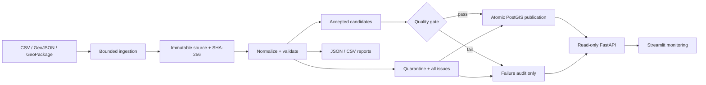
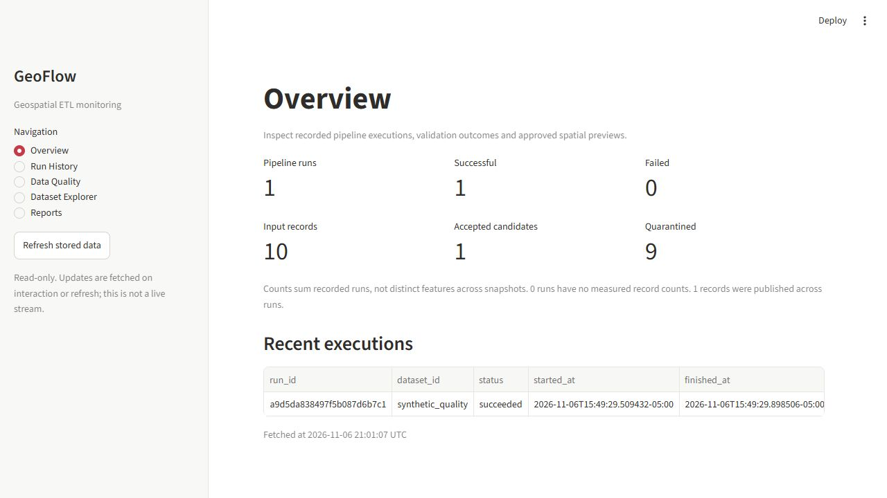
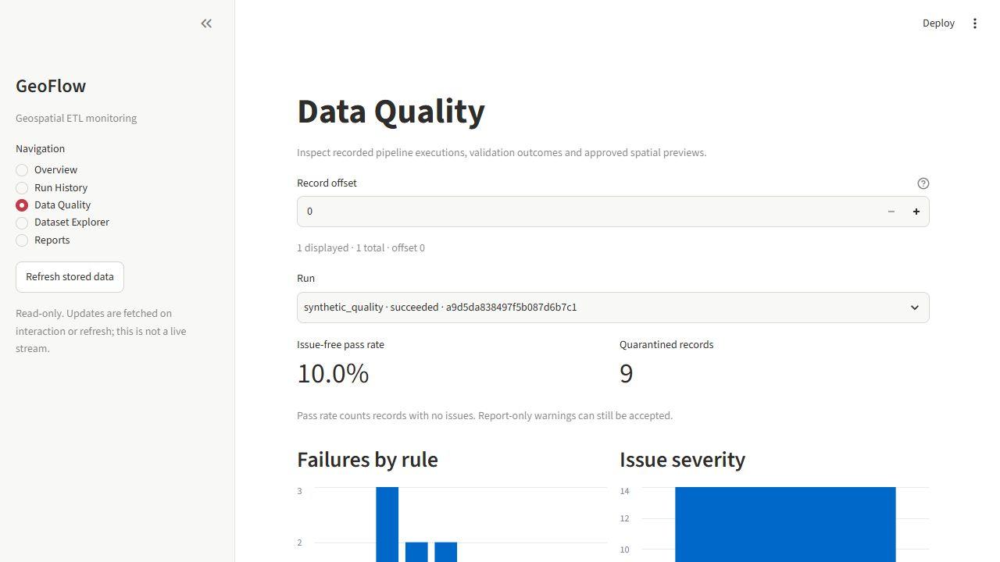
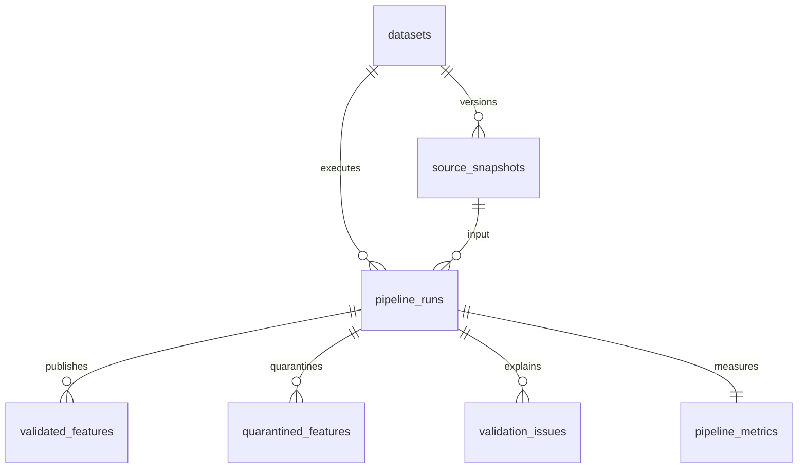

# GeoFlow — Geospatial ETL & Data Quality

**Turn spatial files into validated, traceable PostGIS datasets—and explain every rejected record.**

Python engineering project covering ingestion, geospatial validation, transactional
storage and operational inspection. Built for a Waterloo-area demonstration;
bundled inputs are deliberately synthetic, not municipal analysis results.

**Review in 60 seconds:** inspect the architecture, dashboard and measured example
below. For implementation depth, read [database design](docs/DATABASE.md),
[monitoring API](docs/MONITORING.md) and [verification evidence](VERIFICATION.md).

## Architecture



## Running dashboard

Actual browser screenshots captured on **2026-11-06** from a local Streamlit +
FastAPI + PostgreSQL/PostGIS stack. The selected run uses the corrupted synthetic
fixture; its low pass rate is intentional. No screenshot values were edited.





[View the complete rule/severity chart capture](docs/screenshots/quality-rules.png).
[Capture provenance and measurements](docs/evidence/README.md).

## Features

- CSV coordinate mapping, GeoJSON and named GeoPackage layers; bounded HTTPS acquisition.
- Typed validation rules with INFO/WARNING/ERROR/FATAL severity and explicit dispositions.
- Recoverable raw snapshots, deterministic identifiers and immutable successful runs.
- Seven-table PostGIS history, Alembic migrations, GiST indexing and transactional loading.
- Read-only API, five dashboard pages and opt-in bounded spatial previews.
- Locked dependencies, lint/type checks, tests, manual CI runs and container definitions.

## Data sources and licensing

[Bundled fixtures](data/sample/) are small synthetic files created for this project;
no external download is required. They are test inputs, not real stops, roads or
population estimates. No professional dataset licence is inferred from a catalogue.

GRT's official stop catalogue is a candidate only. Dataset-specific licence version,
schema, CRS, update cadence and download method remain pending in
[the source verification record](docs/SOURCES.md). No public-data sample is bundled
without that verification. No repository-wide open-source licence has been selected;
this README does not grant one or assert third-party redistribution rights.

## ETL and quality rules

Configuration controls acquisition, source/target CRS, field copying, string trimming,
geometry promotion, required columns and custom constraints. CSV values retain their
source strings; type rules do not silently coerce them. Unknown CRS is rejected.

| Checks | Behavior |
| --- | --- |
| Required fields, nulls, field types | Stable codes; multiple issues per record |
| Missing/empty/invalid geometry, expected types | Quarantine; no automatic repair |
| Duplicate source IDs and exact records | Every duplicate member is flagged |
| Finite/plausible coordinates, configured bounds | Evaluate in declared source CRS |
| Dataset-specific ranges/enumerations | Configurable severity and disposition |

Every record receives one disposition: **input = accepted + quarantined**. Rule
counts are affected-record counts; issue counts may be larger. A report-only warning
can remain accepted, but the issue-free pass rate includes no warning-bearing rows.
FATAL errors block publication. Whole-file failures retain available evidence
without inventing record counts.

**Why EPSG:26917?** NAD83 / UTM zone 17N covers the Waterloo demonstration longitude
and uses metres, making local distance/area operations clearer than degree-based
coordinates. The stored geometry is explicitly 2D EPSG:26917; GeoJSON previews use
EPSG:4326. This is a regional choice, not a global CRS or a survey-accuracy claim.
See the [EPSG definition](https://epsg.io/26917); datum realization and transformation
accuracy must be reviewed for actual source data.

## Example input and measured output

Run [configs/quality.yml](configs/quality.yml) with
[data/sample/quality_cases.geojson](data/sample/quality_cases.geojson). Ten features
include a valid control, null geometry, a self-intersecting polygon, duplicate IDs,
a missing field, a wrong type, out-of-bounds coordinates and a null value.

| Measured result | Value |
| --- | ---: |
| Input / accepted / quarantined | 10 / 1 / 9 |
| Validation issues | 14 |
| Issue-free pass rate | 10% |
| Published PostGIS features | 1 |
| Pipeline duration | 0.422413 s |

Evidence: [pipeline report](docs/evidence/synthetic-run.json),
[quality report](docs/evidence/quality.json), [issue CSV](docs/evidence/issues.csv).
This was **one local synthetic run** with native PostgreSQL 17.11/PostGIS 3.6 and
Python 3.12.14. Duration uses the pipeline timer through processing/storage before
final report publication; it excludes database startup, migrations and browser
rendering. It is not a performance benchmark, SLA or estimate for large datasets.

## Database schema



**Idempotency:** run identity hashes source bytes, effective configuration and
application version. Identical successful retries are no-ops. New bytes create a
new checksum-addressed snapshot; changed configuration/version can create a new
run referencing an existing snapshot. Prior successful history is retained.

**Transactions:** one SQLAlchemy transaction publishes the run and its children.
Advisory locks serialize writers per dataset; uniqueness constraints prevent
unintended duplicates. Failed writes roll back. Failed quality runs store evidence
with zero published features. File reports and DB commits are separate boundaries;
rerunning reconciles a crash between them.

**Quarantine:** rejected records retain source values and all issue codes; raw bytes
remain available in source snapshots. The public API omits raw/private records,
source identifiers, credentials and detailed errors. [Schema and SQL queries](docs/DATABASE.md).

## Quick start

From the repository root in Windows 11 PowerShell, with Python 3.12:

```powershell
py -3.12 -m pip install uv==0.12.12
uv sync --frozen --extra dev --extra monitor
uv run --frozen geoflow validate-config configs/quality.yml
uv run --frozen geoflow run configs/quality.yml --dataset synthetic_quality
```

This file-only example needs no database or external data download. YAML paths are
relative to the config file. Exit codes: 0 success, 1 run/quality failure, 2 invalid
CLI/config/report, 130 controlled interruption.

For full local services, use [database setup](docs/DATABASE.md) and
[API/dashboard startup commands](docs/MONITORING.md): API docs at
http://127.0.0.1:8000/docs; dashboard at http://127.0.0.1:8501.
[Docker setup](docs/CONTAINERS.md) uses loopback host ports and named persistent volumes.

Windows sandbox TEMP/cache errors can be addressed with process-local TEMP/TMP and
UV_CACHE_DIR pointing to writable directories; do not weaken system permissions.
For refused database connections, check the service and port; for missing tables,
apply Alembic migrations. Never use a production database for tests.

## Running tests

```powershell
uv run --frozen --extra dev --extra monitor ruff check .
uv run --frozen --extra dev --extra monitor ruff format --check .
uv run --frozen --extra dev --extra monitor mypy
uv run --frozen --extra dev --extra monitor pytest tests/unit -q
uv build --offline
```

For all tests, migrate a disposable PostGIS database, set
GEOFLOW_TEST_DATABASE_URL, then run
`uv run --frozen --extra dev --extra monitor pytest -q`.
Database tests skip without that variable. **176 tests passed** in the final local
suite, including real PostGIS rollback/idempotency and API tests. Mypy checks
32 application modules. See [actual commands and limitations](VERIFICATION.md).

## Automation

CI separates lint/type/unit checks, disposable runner-local PostGIS integration,
and manually selected synthetic ETL. Small report artifacts have seven-day
retention; raw sources/quarantine are excluded. **No recurring schedule is enabled.**
Hosted runners do not connect to the user's Windows database.
[Workflow details](docs/AUTOMATION.md).

## Engineering decisions and tradeoffs

- Bounded in-memory processing simplifies auditability; it is not a distributed engine.
- Exact duplicate detection is deterministic; it is not fuzzy/topological matching.
- Immutable raw bytes make failures recoverable; database snapshot storage has a 100 MB ceiling.
- Generic geometry with fixed regional SRID supports mixed types without guessing CRS.
- Read-only, paginated monitoring reduces exposure; it does not replace authentication.
- No automatic repair avoids silently changing analytical meaning.
- Dependency lockfiles improve repeatability; container/action tags are not immutable digests.

## Known limitations

Docker is unavailable on the development host: image builds, Compose runtime and
container role setup remain unverified. GitHub workflows are defined but have not
run remotely. One upstream TestClient deprecation warning remains. No production
load benchmark, authenticated public deployment, real-source integration or
high-availability claim is made. Monitoring updates on interaction, not streaming.

## Future improvements

Verify and integrate an officially licensed Waterloo dataset; validate the full
Compose stack on Docker; add broader performance measurements and retention
policies; review authentication and least-privilege deployment; extend typing and
source-specific validation. These are plans, not completed features.

[Website case-study copy and resume bullets](docs/PORTFOLIO.md).
