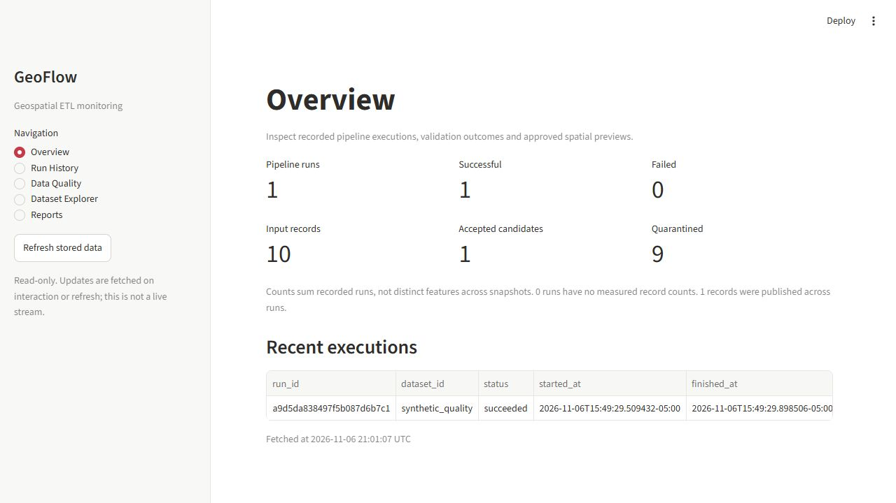
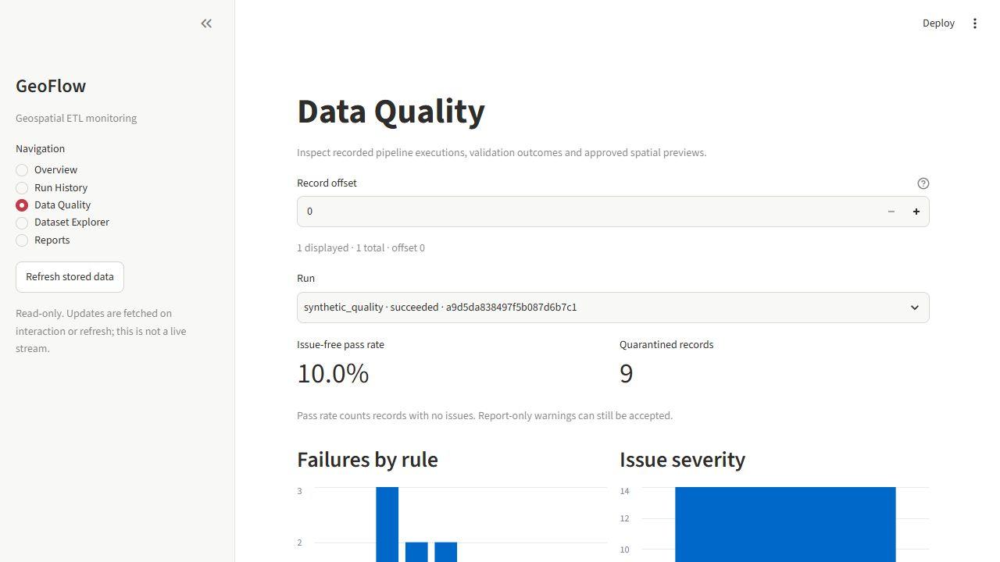

# GeoFlow — portfolio case study

## Overview
GeoFlow is a Python geospatial ETL and data quality platform that converts
configured spatial files into traceable PostGIS run history and inspectable
quality reports. The project demonstrates data engineering and GIS validation
through a reproducible synthetic example rather than unsupported real-world claims.

## Problem
Spatial pipelines can lose rejected records, obscure CRS assumptions and duplicate
results on retries. GeoFlow makes those decisions explicit: preserve the source,
classify every issue, reconcile dispositions and publish database results atomically.

## Architecture and technologies
Python 3.12, GeoPandas, Shapely, PyProj, Pandas, Pydantic, Typer, SQLAlchemy,
Alembic and PostgreSQL/PostGIS. YAML drives ingestion and quality rules; FastAPI
provides a read-only monitoring interface and Streamlit presents five inspection
pages. Pytest, Ruff and mypy support local/CI verification. Docker definitions and
GitHub Actions workflows are prepared; container runtime and remote CI are not yet verified.

## Validation and storage
CSV, GeoJSON and GeoPackage adapters preserve original identifiers and raw bytes.
Rules cover required/null/type checks, geometry validity/type, duplicate IDs/records,
CRS, coordinate plausibility, spatial bounds and custom constraints. Multiple
issues can attach to a record, but it has exactly one final disposition. No unknown
CRS is guessed and no geometry is automatically repaired.

Seven related database tables store datasets, snapshots, runs, validated geometry,
quarantine, issues and metrics. SHA-256/content-based run identity and uniqueness
constraints make identical successful retries safe. Transactions and advisory locks
protect publication; actual database failure tests verify rollback. Storage geometry
is 2D EPSG:26917 and retains raw source bytes separately.

## Automation and monitoring
Manual workflow_dispatch runs use allowlisted synthetic data and seven-day report
artifacts. Scheduled runs stay disabled. Monitoring is GET-only with bounded
pagination, query timeouts, explicit CORS and opt-in geometry-only previews; no
pipeline execution endpoint is exposed.

## Verified results
- Final local suite: 176 tests passed, including real PostGIS integration tests.
- Ruff, mypy (32 application modules) and package build passed.
- Captured synthetic run: 10 inputs = 1 accepted + 9 quarantined; 14 issues; 10% issue-free.
- Measured pipeline duration: 0.422413 seconds for that single local run, including
  publication but excluding service startup and final report writing. Not a benchmark.
- Input 10 and rejection 9 are intentional fixture design, not an operational accuracy claim.

[Machine-readable measurements](evidence/synthetic-run.json) ·
[Quality evidence](evidence/quality.json) · [Detailed verification](../VERIFICATION.md).

## Limitations
Official GRT integration remains pending source/licence/schema/CRS verification.
Docker runtime and GitHub-hosted workflows have not been executed here. Bounded
in-memory processing and 100 MB snapshot limits target a demonstration workload.
No public deployment, production benchmark or authentication claim is made.

## Resume-ready description
**GeoFlow | Geospatial ETL & Data Quality Platform**
Python, GeoPandas, PostgreSQL/PostGIS, SQLAlchemy, FastAPI, Streamlit

- Developed configuration-driven CSV, GeoJSON and GeoPackage ETL with explicit CRS transformation, recoverable source snapshots and per-record spatial quality validation.
- Implemented transactional PostGIS storage across seven related tables with GiST indexing, idempotent loading and quarantine reconciliation; verified rollback and repeat-run behavior against a real database.
- Built read-only API/dashboard monitoring and CI/manual-execution workflows; validated the system with 176 passing tests, including PostGIS integration tests, plus Ruff and mypy checks.

These bullets describe implemented and locally verified work; they do not imply
remote CI execution, production deployment or quantified business impact.
